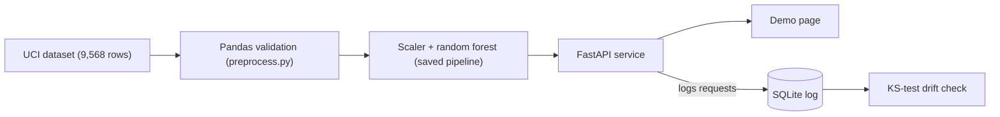

# power-plant-output-prediction# Power Plant Output Prediction

[](https://github.com/darshan-bhilare/power-plant-output-prediction/actions/workflows/ci.yml)

Predict the electrical output of a combined cycle power plant from four ambient measurements, then serve the model as a tested, containerised and monitored web service.

The project has two goals. The first is to understand how a neural network learns, by writing one from scratch in NumPy (including backpropagation) and checking it against PyTorch and scikit-learn. The second is to show the engineering that turns a model into something usable: input validation, a REST API, request logging, automated tests, data drift monitoring and a Docker image that is built and health-checked on every push.

## Contents

- [Summary of results](#summary-of-results)
- [Quick start](#quick-start)
- [The problem and the data](#the-problem-and-the-data)
- [How it works](#how-it-works)
- [What we found](#what-we-found)
- [The service](#the-service)
- [Drift monitoring](#drift-monitoring)
- [Testing and CI](#testing-and-ci)
- [Design decisions](#design-decisions)
- [Limitations](#limitations)
- [Possible next steps](#possible-next-steps)
- [Project structure](#project-structure)
- [Data and references](#data-and-references)

## Summary of results

Scores are on 1,914 held-out test rows, in real power units (MW). Lower MAE, RMSE and MAPE are better; higher R² is better.

| Model | MAE | RMSE | MAPE | R² |
|---|---|---|---|---|
| Linear regression | 3.596 | 4.503 | 0.793 % | 0.9301 |
| scikit-learn MLP | 2.974 | 3.868 | 0.657 % | 0.9484 |
| PyTorch (same network) | 2.903 | 3.818 | 0.639 % | 0.9498 |
| Neural network from scratch (NumPy) | 2.871 | 3.807 | 0.633 % | 0.9500 |
| **Random forest (served)** | **2.328** | **3.245** | **0.513 %** | **0.9637** |

In short:

- The from-scratch network matches PyTorch and scikit-learn to within 0.002 R², which is good evidence that its hand-written backpropagation is correct. A numerical gradient check agrees (worst difference 2.6e-11).
- The random forest is the most accurate model, so it is the one the service uses. The neural networks did not beat it.
- A drift check flags a simulated 8 degree temperature shift (p = 1.5e-20) and stays quiet on normal traffic.

## Quick start

Requirements: Python 3.10 or newer. (Docker is optional.)

```powershell
python -m venv venv
venv\Scripts\Activate.ps1          # on macOS/Linux: source venv/bin/activate
pip install -r requirements.txt pytest httpx
uvicorn main:app --reload
```

Open http://127.0.0.1:8000 for the interactive demo page, or http://127.0.0.1:8000/docs for the API documentation.

Run with Docker instead:

```powershell
docker build -t power-plant-api .
docker run -p 8000:8000 -v power-plant-data:/data power-plant-api
```

Run the tests:

```powershell
python -m pytest -v
```

Rebuild the saved model from the data: `python save_model.py`. The neural network comparison and experiments also need PyTorch (`pip install torch`).

## The problem and the data

A combined cycle power plant makes electricity with gas and steam turbines. How much it produces depends on the surroundings. Given four hourly average measurements, the task is to predict the plant's net hourly electrical output. This is a regression problem on a small table of numbers.

The data is the UCI Combined Cycle Power Plant dataset: 9,568 hourly readings collected over six years (2006 to 2011) while the plant ran at full load, with no missing values.

| Column | Meaning | Range in the data | Link with output |
|---|---|---|---|
| AT | Ambient temperature (°C) | 1.81 to 37.11 | Strongly negative (-0.95) |
| V | Exhaust vacuum (cm Hg) | 25.36 to 81.56 | Strongly negative (-0.87) |
| AP | Ambient pressure (millibar) | 992.89 to 1033.30 | Moderately positive (0.52) |
| RH | Relative humidity (%) | 25.56 to 100.16 | Weakly positive (0.39) |
| PE | Net hourly output (MW), the target | 420.26 to 495.76 | |

The link column shows correlation in this data. It describes a pattern, not a cause.

**Evaluation setup.** 80% of the rows train the model and 20% are held out for testing (7,654 and 1,914 rows, `random_state=42`). Scaling is learned from the training rows only, so the test rows never influence it. Every model in this project uses the same split.

## How it works



1. **Explore and baseline.** Load the data, check it, and set baselines with linear regression and a random forest.
2. **Build the network from scratch.** A fully connected network in NumPy with forward pass, backpropagation, mini-batches, L2 regularisation and three optimisers (plain SGD, momentum, Adam). It was first checked on a sine curve and with a numerical gradient check before touching the real data.
3. **Compare fairly.** The same architecture (4-32-16-1, tanh, Adam, learning rate 0.003, batch size 128, 500 epochs) was rebuilt in PyTorch and scikit-learn.
4. **Experiment.** Batch size, activation function, network size, learning rate, L2 strength and optimiser were varied on the power plant data.
5. **Package.** Input validation with pandas (`preprocess.py`) is shared by training and serving. Scaling and the random forest are saved together as one scikit-learn pipeline.
6. **Serve and monitor.** A FastAPI service answers predictions, logs real requests to SQLite, and exposes a drift check that compares logged inputs with the training data.
7. **Test and ship.** Automated tests cover the API, validation and drift check. GitHub Actions runs them and builds and health-checks the Docker image on every push.

## What we found

All neural network runs below use the 4-32-16-1 network unless stated, with one random seed each. R² is on the test rows.

**1. The from-scratch network is correct.** Its gradients match numerical gradients (worst difference 2.6e-11), it learns sin(x) on [-3, 3], and on the real data it scores within 0.002 R² of PyTorch and scikit-learn.

**2. Adam is the most forgiving optimiser.** Plain gradient descent was sensitive to the learning rate. On the sine curve, with full-batch training for 10,000 steps, a rate of 0.1 bounced around (final loss 0.0164), 0.03 worked best (0.0021) and 0.01 was too slow (0.0058). With mini-batches for 1,000 epochs, the final loss was 0.0030 for SGD, 0.0013 for momentum and 0.00026 for Adam. On the power plant data, with identical settings:

| Optimiser | Learning rate | Test R² |
|---|---|---|
| Adam | 0.003 | 0.9500 |
| Momentum | 0.003 | 0.9468 |
| SGD | 0.03 | 0.9454 |
| SGD | 0.1 | 0.9450 |

**3. L2 regularisation only hurt.** The network is not overfitting (train and test R² are nearly equal), so a penalty on the weights just holds it back.

| L2 strength | Test R² | Train R² |
|---|---|---|
| 0 | 0.9500 | 0.9541 |
| 0.0001 | 0.9495 | 0.9493 |
| 0.001 | 0.9430 | 0.9414 |
| 0.01 | 0.9395 | 0.9379 |

**4. Activation, size and batch size barely mattered.** ReLU did not beat tanh (0.9465 to 0.9491 against 0.9500). A wider 64-64 tanh network reached 0.9523. Batch sizes 32, 64 and 128 differed by about 0.001, and training five times longer (200 to 1,000 epochs) moved R² by about 0.001. Every setting landed between about 0.940 and 0.952.

**5. Tree models win on this data.** The random forest (R² 0.9637) beat every neural network. That is common for small tables of numeric data and is not a sign of a faulty network.

**6. Validation rules must be tested against real data.** The first humidity limit was 0 to 100, because humidity cannot exceed 100%. It rejected real training rows: 55 of the 9,568 have humidity slightly above 100 (maximum 100.16), which is sensor noise. The limit is now 105.

**7. Monitoring checks can raise false alarms.** The first drift check flagged temperature on normal traffic (p = 0.042). With four columns tested at once, a 0.05 cutoff gives a false alarm about 19% of the time. Dividing the cutoff by the number of columns (a Bonferroni correction) fixed it. A real shift is still caught easily (see below).

## The service

| Endpoint | Purpose |
|---|---|
| `GET /` | Interactive demo page |
| `POST /predict` | Predict output from the four inputs |
| `GET /health` | Returns `{"status": "ok"}` |
| `GET /ranges` | Training data ranges and three real example readings |
| `GET /drift` | Drift check on recent logged requests |
| `GET /docs` | Interactive API documentation |

**Predict:**

```powershell
Invoke-RestMethod -Uri http://127.0.0.1:8000/predict -Method Post -ContentType "application/json" -Body '{"AT":14.96,"V":41.76,"AP":1024.07,"RH":73.17}'
```

```json
{"predicted_power_MW": 463.52}
```

Inputs must be numbers within physical limits (AT -50 to 60, V 0 to 150, AP 800 to 1100, RH 0 to 105). Anything else gets a `422` response with an explanation. Every successful request is logged to SQLite, except when `?log=false` is passed.

**Demo page.** The page at `/` has four sliders, three real example readings (a cool, a typical and a hot day) and a live predicted output. It warns when a value is outside the range the model learned from, and it can run the drift check in plain English. Slider previews use `log=false`, so they do not affect the log or the drift check.

**Configuration.** The log location is set with the `DB_PATH` environment variable (default `requests.db`; `/data/requests.db` in Docker).

## Drift monitoring

Drift means that incoming data slowly stops looking like the data the model learned from. The model does not crash when this happens. It just becomes less reliable.

`drift.py` compares each input column of the logged requests with the training inputs using a two-sample Kolmogorov-Smirnov test. A column is flagged when its p-value is below 0.05 divided by the number of columns tested. The check needs at least 30 logged requests and uses the most recent 500 at most.

Results on simulated traffic (200 requests sampled from the training data):

| Traffic | AT (temperature) | V | AP | RH |
|---|---|---|---|---|
| Normal | ok (p = 0.042) | ok | ok | ok |
| Temperature shifted up 8 °C | **drift** (KS = 0.340, p = 1.5e-20) | ok | ok | ok |

To reproduce this: start the service, run `python simulate_traffic.py normal` (or `drift`), then run `python drift.py`. Delete `requests.db` between runs.

## Testing and CI

The test suite covers the API (validation, sensible predictions, logging), the pandas validation steps, the drift check, and the demo endpoints. Run it with `python -m pytest -v`. Tests use a temporary database and never touch the real log.

The GitHub Actions workflow (`.github/workflows/ci.yml`) runs two jobs on every push:

1. **tests:** installs the pinned requirements and runs the test suite.
2. **docker:** builds the image, starts the container, waits for `/health`, and requests a prediction.

## Design decisions

- **Serve the random forest, not the neural network.** It scored best, and its scaler and model save as one file.
- **Same validation code for training and serving.** `preprocess.py` is used by both, so the model never sees data cleaned differently from its training data.
- **Pinned library versions.** The model file is created with scikit-learn 1.9.1, and `requirements.txt` pins that version. Loading a model with a different version triggers warnings and can give wrong results.
- **Training inputs ship with the model.** `models/train_features.csv` powers the drift check and the ranges on the demo page.
- **Previews are not logged.** Only real API requests count towards drift, so dragging a slider cannot distort the monitoring.
- **Wide input limits.** The API rejects only impossible values, so unusual but possible inputs reach the model and show up in the drift check.

## Limitations

- **Tuning used the test set.** There is no separate validation set, so the settings in the experiment tables were compared on the same rows used for the final scores. The neural network numbers may be slightly optimistic.
- **One random seed per run.** Differences of about 0.003 R² or less should not be read as real.
- **Full-load data only.** The data comes from a plant running at full load, so the model says nothing about other operating conditions.
- **One plant, one period.** The model is not expected to carry over to other plants or to conditions outside the training ranges.
- **Drift check covers inputs only.** It shows that incoming data looks different from the training data. It does not show that predictions got worse, because that needs true outcomes. A flagged column is a prompt to investigate, not proof of a problem.
- **No authentication or rate limiting.** The service is a demonstration and should not be exposed publicly as it is.
- **Docker was verified in CI.** The image is built and health-checked by GitHub Actions on every push.

## Possible next steps

- Add a validation set or cross-validation, and repeat experiments over several random seeds.
- Compare the models with the paper's 5x2 cross-validation protocol from the dataset's documentation.
- Track prediction quality over time once true outputs are available, not only input drift.
- Add authentication, rate limiting and model versioning before any public deployment.

## Data and references

- Tüfekci, P. & Kaya, H. (2014). *Combined Cycle Power Plant* [Dataset]. UCI Machine Learning Repository. https://doi.org/10.24432/C5002N. Licensed under CC BY 4.0.
- Tüfekci, P. (2014). Prediction of full load electrical power output of a base load operated combined cycle power plant using machine learning methods. *International Journal of Electrical Power & Energy Systems*, 60, 126-140.

Author: Darshan Bhilare